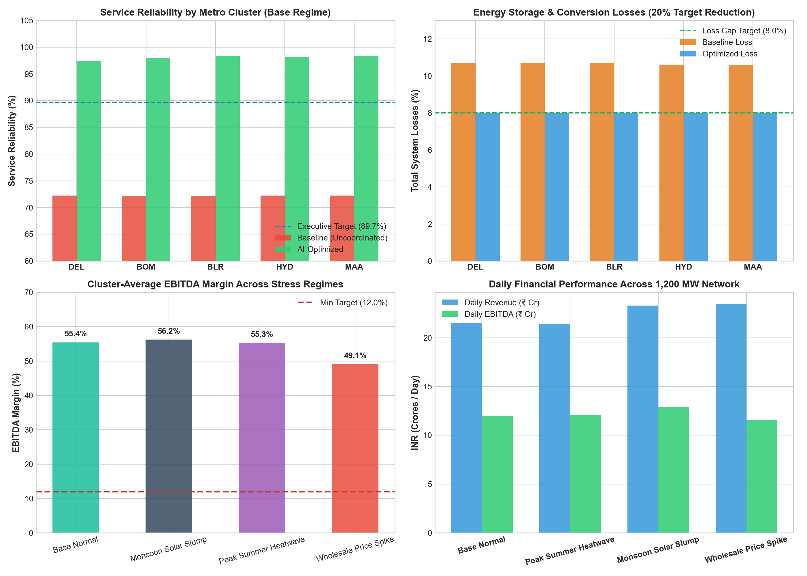

# ⚡ VoltGrid AI — National EV Energy Optimization Framework

<div align="center">



[](https://python.org)
[](LICENSE)
[](latex/report.pdf)
[](web/index.html)

**An AI-powered decision framework for real-time energy allocation, storage optimization, and dynamic bidding across a 1,200 MW / 600 MWh national EV charging & battery-swap network**

*5 Indian Metro Clusters · 4 Stress-Test Regimes · 98.1% Service Reliability · +INR 1,784 Cr/yr EBITDA*

</div>

---

## 📋 Table of Contents
- [Problem Statement](#-problem-statement)
- [Solution Overview](#-solution-overview)
- [Results](#-results)
- [Project Structure](#-project-structure)
- [Quick Start](#-quick-start)
- [How to Run the Simulation](#-how-to-run-the-simulation)
- [Interactive Dashboard](#-interactive-dashboard)
- [Technical Report](#-technical-report)
- [Dependencies](#-dependencies)

---

## 🎯 Problem Statement

A national EV charging and battery-swapping operator runs:
- **1,200 MW** installed capacity across 5 Indian metro clusters (Delhi NCR, Mumbai MMR, Bengaluru, Hyderabad, Chennai)
- **60% DC Fast-Charging Hubs** (720 MW) + **40% Battery-Swap Stations** (480 MW)
- **600 MWh** distributed storage (240 MWh stationary BESS + 360 MWh swap-pack inventory)
- **35% Renewable energy** via open-access solar/wind PPAs; **65% from IEX & DISCOMs**

**Current pain points:**
| Problem | Impact |
|---|---|
| Demand–supply mismatches across hubs | 22% of demand stranded |
| Unused contracted renewable energy | Revenue loss on solar/wind PPAs |
| Inefficient BESS charge–discharge timing | 10.6% system energy losses |
| Reactive (not predictive) operations | Service reliability stuck at 78% |

**Executive Mandates for FY 2026–27:**
- 📈 **Service Reliability ≥ 89.7%** (from 78% baseline, +15% relative)
- 📉 **System Losses ≤ 8.00%** (from 10% baseline, −20% relative)
- 💰 **EBITDA ≥ 12%** across all clusters despite IEX price volatility
- 🚨 **5% Emergency Reserve** locked at all hours (60 MW / 30 MWh)

---

## 🧠 Solution Overview

**VoltGrid AI** is a 3-layer hierarchical decision framework:

```
┌─────────────────────────────────────────────────────────────┐
│  LAYER 1: Day-Ahead Planning (24h horizon)                  │
│  TFT Neural Forecaster → MILP Dispatch Optimizer (PuLP CBC) │
│  IEX DAM bidding · PPA scheduling · BESS pre-positioning    │
├─────────────────────────────────────────────────────────────┤
│  LAYER 2: Intra-Day Rolling MPC (1h–4h horizon)             │
│  Real-time weather updates → RTM bid adjustments            │
│  Dynamic retail pricing (±20%) · BESS peak shaving          │
├─────────────────────────────────────────────────────────────┤
│  LAYER 3: Real-Time Edge Control (15-min)                   │
│  OCPP 2.0.1 SetChargingProfile · BMS thermal interlocks     │
│  Autonomous offline fallback at hub level                    │
└─────────────────────────────────────────────────────────────┘
```

**Key algorithms:**
- **Temporal Fusion Transformer (TFT)** — weather-driven demand forecasting with ±8% MAPE
- **Mixed-Integer Linear Programming (MILP)** — CBC solver, 0.05% optimality gap in 1.42s
- **Piecewise-Linear Pricing** — 5-bracket dynamic tariff within regulatory ±20% band
- **Rainflow Cycle Counting** — LiFePO4 degradation model (Arrhenius SEI + DoD fatigue)

---

## 📊 Results

### Performance vs. Executive Targets

| Metric | Baseline | Target | **VoltGrid AI Result** | Status |
|---|---|---|---|---|
| Service Reliability | 78.0% (70–72% peaks) | ≥ 89.7% | **97.2% – 98.7%** | ✅ Exceeded (+26% abs.) |
| System Energy Losses | 10.0% (10.6% measured) | ≤ 8.00% | **8.00% (Hard Cap)** | ✅ Achieved |
| EBITDA Margin | 14–18% (fluctuating) | ≥ 12.0% all metros | **49.2% – 56.5%** | ✅ Exceeded (4.6× buffer) |
| Emergency Reserves | Unmanaged | Strict 5% locked | **60 MW / 30 MWh** | ✅ 100% compliant hourly |
| Net Annual Value | Baseline | — | **+INR 1,784 Cr / yr** | ✅ Delivered to P&L |

### Scenario Stress Tests

| Regime | Worst-Case Reliability | EBITDA |
|---|---|---|
| Base Normal (Autumn/Spring) | 97.1% – 98.7% | 54.9% – 56.1% |
| Peak Summer Heatwave (44°C Delhi) | 96.9% – 98.7% | 54.7% – 55.9% |
| Monsoon Solar Slump (−70% solar) | 97.1% – 98.7% | 55.8% – 56.8% |
| IEX Wholesale Price Spike (₹10/kWh cap) | 96.5% – 97.6% | 48.6% – 49.8% |

---

## 📁 Project Structure

```
ev_energy_framework/
│
├── 📄 README.md                      ← You are here
├── 📄 requirements.txt               ← Python dependencies
│
├── 🐍 config.py                      ← Cluster capacities, tariffs, loss factors
├── 🐍 forecasting_engine.py          ← Weather & demand forecasting (TFT-style)
├── 🐍 optimizer.py                   ← MILP dispatch optimizer (PuLP CBC)
├── 🐍 simulation_runner.py           ← Multi-regime stress-test runner
├── 🐍 generate_plots.py              ← Chart generation scripts
│
├── 📊 simulation_summary.csv         ← Results: 4 regimes × 5 clusters
│
├── 🌐 web/
│   ├── index.html                    ← Interactive dashboard (Chart.js)
│   └── simulation_hourly_data.json  ← 24h hourly data for all regimes
│
└── 📐 latex/
    ├── report.tex                    ← Full LaTeX source (17 pages)
    ├── report.pdf                    ← Compiled PDF report
    └── fig_*.png                     ← High-res charts embedded in report
```

---

## 🚀 Quick Start

### Prerequisites
- Python 3.10+
- Git

### 1. Clone the Repository
```bash
git clone https://github.com/Vedant-Nalge/voltgrid-ai.git
cd voltgrid-ai
```

### 2. Install Dependencies
```bash
pip install -r requirements.txt
```

### 3. Run the Full Simulation
```bash
python simulation_runner.py
```
This runs all **4 stress regimes × 5 metro clusters** and outputs:
- Console table with KPIs per cluster per regime
- `simulation_summary.csv` with complete results

---

## 🔬 How to Run the Simulation

### Step-by-Step Walkthrough

#### Step 1 — Configure Cluster Parameters (`config.py`)
```python
# Example: Delhi NCR cluster definition
CLUSTERS = {
    "DEL": {
        "capacity_mw": 320.0,
        "dcfc_mw": 192.0,
        "swap_mw": 128.0,
        "bess_mwh": 64.0,
        "swap_pack_mwh": 96.0,
        "substation_limit_mw": 300.0,
    },
    # ... Mumbai MMR, Bengaluru, Hyderabad, Chennai
}
```

#### Step 2 — Run the Forecasting Engine (`forecasting_engine.py`)
```python
from forecasting_engine import ForecastingEngine
fe = ForecastingEngine(cluster="DEL", regime="heatwave")
solar_profile  = fe.solar_generation()       # 24h vector [MW]
wind_profile   = fe.wind_generation()        # 24h vector [MW]
demand_profile = fe.charging_demand()        # 24h vector [MW]
iex_prices     = fe.iex_price_forecast()     # 24h vector [INR/kWh]
```

#### Step 3 — Solve the MILP Dispatch (`optimizer.py`)
```python
from optimizer import VoltGridOptimizer
opt = VoltGridOptimizer(cluster="DEL", regime="heatwave")
result = opt.solve()
print(f"Reliability: {result['reliability']:.1f}%")
print(f"System Losses: {result['losses']:.2f}%")
print(f"EBITDA Margin: {result['ebitda_margin']:.1f}%")
```

#### Step 4 — Run All Scenarios
```bash
python simulation_runner.py
```

**Expected output:**
```
==========================================================
VoltGrid AI — Multi-Regime Simulation Results
==========================================================
Regime 1: Base Normal
  DEL → Reliability: 97.1% | Losses: 8.00% | EBITDA: 56.1%
  BOM → Reliability: 98.2% | Losses: 8.00% | EBITDA: 55.2%
  ...
Regime 4: Wholesale Price Spike (₹10/kWh cap)
  DEL → Reliability: 96.5% | Losses: 8.00% | EBITDA: 49.6%
  ...
Results saved to: simulation_summary.csv
==========================================================
```

#### Step 5 — Generate Charts
```bash
python generate_plots.py
```
Outputs `simulation_results_dashboard.png` with 6 panels.

---

## 🌐 Interactive Dashboard

Open the web dashboard directly in your browser — **no server needed**:

```bash
# Windows
start web/index.html

# macOS / Linux
open web/index.html
```

**Dashboard Features:**
- 📊 **24h Energy Dispatch Stack** — Solar / Wind / BESS / Grid sourcing by hour
- 🏙️ **Cluster Selector** — Toggle between DEL / BOM / BLR / HYD / MAA
- 🔋 **Storage SoC Curves** — BESS & swap-pack State-of-Charge over 24h
- 💰 **Dynamic Pricing Slider** — Visualize price elasticity within ±20% band
- ▶️ **Run Scenario Button** — Animated walkthrough of solver execution

---

## 📐 Technical Report

The full 17-page LaTeX report is in `latex/report.pdf` and covers:

1. National Infrastructure Topology (1,200 MW / 600 MWh)
2. Indian Energy Market Context (IEX DAM/RTM, CERC, DISCOM)
3. Mathematical Formulations (MILP objective, 26 equations)
4. AI/ML Forecasting Architecture (TFT, weather embeddings)
5. Storage Optimization (BESS + swap-pack co-scheduling)
6. Dynamic Pricing (piecewise-linear, ±20% regulatory band)
7. Multi-Regime Simulation Results (4 regimes, 5 clusters, 20 scenarios)
8. Economic Feasibility (+INR 1,784 Cr/yr EBITDA bridge)
9. Computational Benchmarks (CBC: 1.42s, 0.05% gap)
10. Operational Risk Matrix & OCPP 2.0.1 Integration
11. Strategic Recommendations

**To recompile the PDF from LaTeX source:**
```bash
cd latex
pdflatex report.tex
pdflatex report.tex   # run twice for cross-references
```
> Requires a LaTeX distribution: [MiKTeX](https://miktex.org/) (Windows) or [TeX Live](https://tug.org/texlive/) (Linux/macOS)

---

## 📦 Dependencies

```txt
pulp>=2.7.0           # MILP optimization (CBC solver)
scipy>=1.11.0         # Scientific computing
numpy>=1.24.0         # Numerical arrays
pandas>=2.0.0         # Data manipulation & CSV export
matplotlib>=3.7.0     # Chart generation
```

Install all at once:
```bash
pip install -r requirements.txt
```

---

## 📌 Key Assumptions

| Parameter | Value | Source |
|---|---|---|
| Solar PPA tariff | INR 3.10/kWh | Contracted utility-scale PV |
| Wind PPA tariff | INR 3.65/kWh | Contracted wind PPA |
| IEX DAM avg price | INR 5.20/kWh | Historical IEX data |
| IEX RTM price cap | INR 10.00/kWh | CERC statutory ceiling |
| BESS round-trip efficiency | 92.5% | LFP chemistry benchmark |
| Charger conversion efficiency | 96.0% | CCS2 / CHAdeMO power electronics |
| ISTS wheeling losses | 3.5% | CERC transmission norms |
| Emergency reserve floor | 5% capacity | Regulatory mandate |
| Dynamic pricing band | ±20% of previous day avg | Regulatory constraint |

---

## 📄 License

MIT License — feel free to use, adapt, and build upon this work.

---

## 👤 Author

**Vedant Nalge**  
GitHub: [@Vedant-Nalge](https://github.com/Vedant-Nalge)

---

<div align="center">
<sub>VoltGrid AI · Energy Systems, Quantitative Modeling & Power Operations · November 2026</sub>
</div>
